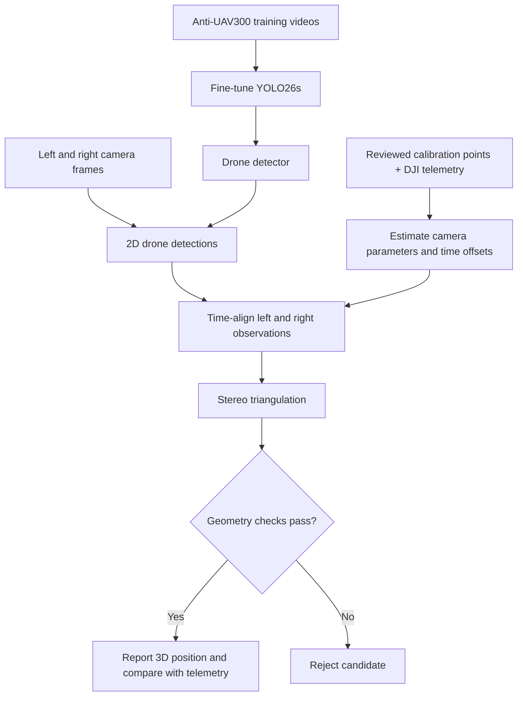

# Drone Detection and Stereo 3D Localization

I built a Python workflow to detect a small drone in stereo camera images and estimate its 3D position. It combines YOLO26s detection, camera calibration, time alignment, and triangulation.

## Highlights

- **Drone detection:** Detected 73 of 78 annotated drone instances
  (5 false negatives, 1 false positive) across 82 held-out
  validation images.

- **Stereo localization for validation:** 33 of 41 stereo pairs
  produced valid 3D estimates (80.5% coverage), with a median
  difference of 0.91 m from DJI telemetry.

- **Stereo localization for later same-flight test:** 21 of 42
  stereo pairs produced valid 3D estimates (50.0% coverage),
  with a median difference of 1.18 m from DJI telemetry.

## Overview

This repository contains the code I wrote for a team project during my MSc studies in Image Analysis and Machine Learning at Uppsala University.

My work covered:

- Preparing Anti-UAV300 training data and fine-tuning YOLO26s for drone detection.
- Comparing full-frame and overlapping-tile inference on stereo images.
- Estimating camera poses, focal lengths, and time offsets using reviewed observations and DJI telemetry.
- Matching left and right observations, triangulating 3D positions, and evaluating the results.

The repository includes the training, detection, and localization scripts, unit tests, and a synthetic example.

## Pipeline

The detector provides 2D observations from both cameras. Camera calibration uses manually reviewed drone centers and DJI telemetry from the calibration interval. The localization stage aligns the observations in time, triangulates positions, and applies geometric checks.



The synthetic example in Getting started generates camera observations to exercise the localization pipeline.

## Method

### 1. Drone detection

I fine-tuned `yolo26s.pt` for single-class drone detection using visible-light sequences from Anti-UAV300. The training script samples video frames, converts bounding boxes to YOLO format, includes empty background frames, and splits the data by **whole video**. It exports the trained model as `anti_uav_best.pt`.

I compared three inference methods on the exported stereo images:

| Method | Processing |
| --- | --- |
| Full-frame (`whole`) | Run YOLO26s on the entire image. |
| Tiled (`tiled`) | Combine full-frame predictions with predictions from overlapping tiles, then apply class-aware NMS. |
| Tiled + merging (`tiled_merged`) | Further merge overlapping boxes from the combined predictions. |

I also fine-tuned the detector with challenging Flight01 backgrounds. This increased false positives on the held-out validation images, so I selected the Anti-UAV300-trained model for localization.

### 2. Camera calibration

I matched manually reviewed 2D drone centers with 3D positions from DJI telemetry in the calibration interval. Positions use a local **East / North / DJI-relative-height** coordinate system.

I initialized the camera poses with **PnP-RANSAC** and refined the poses, effective focal lengths, and time offsets using robust nonlinear least squares. I evaluated the fitted models with reprojection residuals and positive-depth checks. Camera separation and orientation were estimated from the observations.

### 3. Stereo triangulation

After calibration, I kept the camera models fixed. I matched left and right observations by corrected timestamps, using nearby detections or interpolation within the same data split.

I converted the observations to camera rays and triangulated a 3D position. Estimates passed checks for positive depth, ray intersection angle, and stereo reprojection error. I compared the accepted positions with DJI telemetry at the corresponding times.

## Experimental results

I evaluated detection and localization on Flight01, a separate recording from the Anti-UAV300 training data.

### Detection on held-out validation images

| Metric | Result |
| --- | ---: |
| Stereo image pairs | 41 |
| Images | 82 |
| Manually annotated drone instances | 78 |
| True positives | 73 |
| False positives | 1 |
| False negatives | 5 |

The detection counts come from manually annotated validation images.

### Stereo localization

| Metric | Validation | Same-flight test |
| --- | ---: | ---: |
| Stereo pairs | 41 | 42 |
| Valid 3D estimates | 33 | 21 |
| Localization coverage | 80.5% | 50.0% |
| Median 3D difference from DJI telemetry | 0.91 m | 1.18 m |

The distance metric is the 3D difference from DJI telemetry. Validation and the later test use separate time intervals from the same flight. The table records results from the original Flight01 experiments.

### Data splits

I split Anti-UAV300 into training, validation, and internal test subsets by whole video sequence. For Flight01, I used these intervals:

| Export-relative interval | Purpose |
| --- | --- |
| 0 to less than 120 s | Camera calibration |
| 120 to less than 125 s | Excluded buffer |
| 125 to less than 166 s | Validation |
| 166 s onward | Same-flight test |

The buffer interval is excluded from fitting and evaluation.

### Failure analysis

- Additional fine-tuning on Flight01 backgrounds increased false positives on validation. I kept the Anti-UAV300-trained detector.
- The localization pipeline rejects pairs with missing detections, unavailable time-aligned observations, or failed geometry checks.
- Valid-estimate coverage decreased from 80.5% on validation to 50.0% in the later test interval. A per-stage count of rejected pairs is the next step in analyzing this decrease.

## Repository structure

```text
drone-detection-and-stereo-localization/
├── README.md
├── requirements.txt
├── .gitignore
├── train_anti_uav.py
├── flight01_detection.py
├── flight01_gps_localization.py
├── examples/
│   ├── generate_synthetic_flight01.py
│   └── detection_config.example.json
└── tests/
    └── test_core.py
```

## Getting started

Use Python 3.11 or newer and install the dependencies in `requirements.txt`. The detection script was developed with `ultralytics==8.4.166`.

```bash
python -m pip install -r requirements.txt
```

### Run a synthetic localization example

The synthetic example generates 2D detections using camera projections and exercises calibration, time alignment, and stereo localization.

First, generate the fictional inputs:

```bash
python examples/generate_synthetic_flight01.py --output-dir synthetic_flight01
```

Then run the localization pipeline:

```bash
python flight01_gps_localization.py --results-path synthetic_flight01 --srt-path synthetic_flight01/flight_telemetry.srt --metadata-path synthetic_flight01/extractedVideoMetadata.txt --output-root outputs
```

The generator produces `predictions_tiled_merged.csv`, `run_info.json`, `flight_telemetry.srt`, and `extractedVideoMetadata.txt` with fictional values. The localization code writes camera parameters, estimated time offsets, 3D coordinates, CSV/JSON summaries, and diagnostic figures to a timestamped output directory.

### Train the drone detector

The training script uses the public Anti-UAV300 archive from `VoyageWang/antiuav` on Hugging Face. It also accepts a local archive through `--archive`. A CUDA GPU is recommended for training.

```bash
python train_anti_uav.py --work-dir anti_uav_work --epochs 30
```

The resulting model is exported to:

```text
anti_uav_work/exported_model/anti_uav_best.pt
```

The Anti-UAV300 test subset is an internal whole-video split. Flight01 uses the separate time-based intervals listed above.

### Run detection on exported stereo images

Set the left/right JPEG folders, their `frames.csv` manifests, and a trained YOLO checkpoint in `examples/detection_config.example.json`:

```bash
python flight01_detection.py --config examples/detection_config.example.json
```

The detector exports per-camera predictions, frame summaries, timing statistics, and candidate stereo pairs. I calculated TP, FP, and FN using manual annotations.

### Run tests

```bash
python -m unittest discover -s tests -v
```

## Limitations

- Calibration assumes static cameras, an image-centered principal point, and zero lens distortion.
- Time alignment estimates a constant offset for each camera. Clock drift remains unmodeled.
- Triangulation requires suitable observations in both views. Missing or ambiguous detections lower 3D coverage.
- DJI telemetry provides the positioning reference and includes measurement and timing uncertainty.
- Evaluation covers one flight. Further flights and independent camera measurements would help test generalization.

## Data and acknowledgments

The training code uses YOLO26s from [Ultralytics](https://github.com/ultralytics/ultralytics) and visible-light sequences from the [Anti-UAV project](https://github.com/ZhaoJ9014/Anti-UAV). The dataset archive is available on [Hugging Face](https://huggingface.co/datasets/VoyageWang/antiuav/tree/main). The corresponding licenses and dataset terms apply.

This repository contains my Python code, tests, configuration examples, and synthetic observations. Original flight recordings, telemetry, camera metadata, and trained model weights are kept outside the repository.
